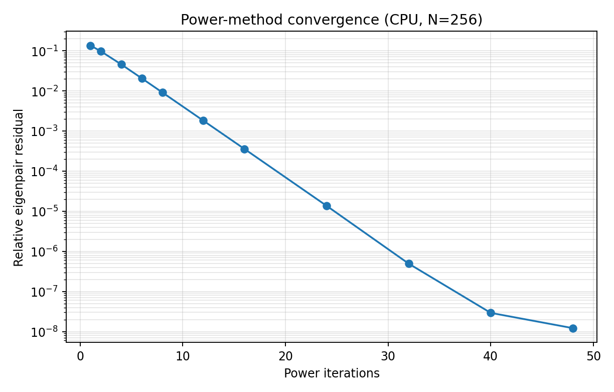
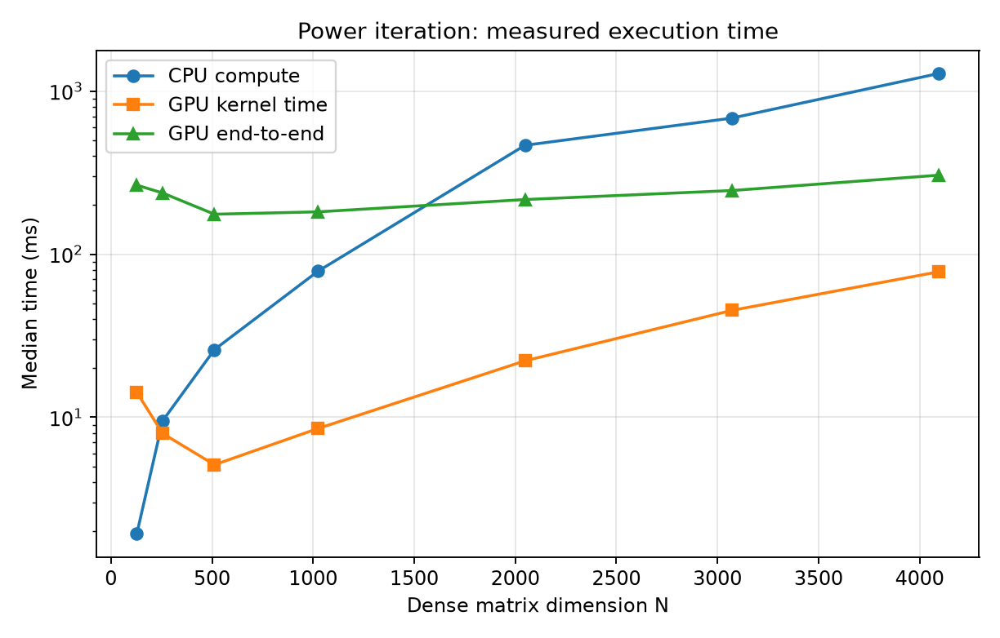
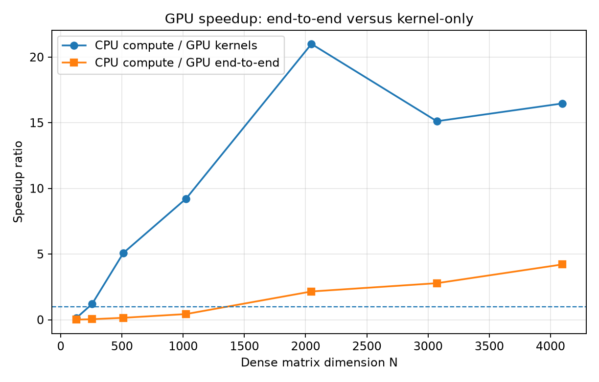

# CUDA Parallel Power Method for Dominant Eigenvalues

A C++/CUDA implementation of **power iteration** for estimating the dominant
eigenvalue and eigenvector of a dense matrix. Developed around GPU-computing
concepts studied in the **High Performance Computing** course during the MSc
Applied Mathematics programme at **TU Delft**.

The project includes a CPU reference implementation and GPU kernels for:
- dense matrix-vector multiplication, with warp-level reduction;
- shared memory parallel reduction to compute the vector norm;
- GPU side normalization of the iteration vector;
- validation of the eigenvalue with a known spectrum and of the eigenvector
  through the relative eigenpair residual.



## Mathematical problem

Power iteration generates successive approximations to the dominant
unit eigenvector:

\[
v_{k+1}=\frac{Av_k}{\|Av_k\|_2},\qquad
\lambda_k=\frac{v_k^TAv_k}{v_k^Tv_k}.
\]

A deterministic, positive definite **dense test matrix**
\(A=2I+\mathbf{1}\mathbf{1}^T/N\) is used so that the true dominant
eigenvalue is known analytically to be **3** (all other eigenvalues equal
2). The program executes the requested number of iterations, then reports the
Rayleigh quotient and relative residual \(\|Av-\lambda v\|_2/\|Av\|_2\).

Both implementations explicitly multiply the **dense** matrix; they do not
exploit the special rank one shortcut. See [numerical notes](docs/numerics.md).

## Requirements

For CPU-only correctness tests: Linux/WSL, `g++`, `make`, and Python 3.

For GPU computation: a supported **NVIDIA CUDA GPU**, NVIDIA Windows GPU
driver (when running WSL 2), and `nvcc` from the NVIDIA CUDA Toolkit.
CUDA compilation and running are separate from the CPU-only tests.

On WSL 2, use the [official NVIDIA CUDA on WSL guide](https://docs.nvidia.com/cuda/wsl-user-guide/)
for GPU and toolkit installation. **Do not install a Linux GPU driver inside
WSL:** the GPU driver comes from Windows. CUDA Toolkit support also depends on
your GPU architecture and driver version.

## Build and test

```bash
make cpu
make test                   # CPU reference and numerical correctness
./bin/power_cpu --n 256 --iterations 48
```

When `nvcc` and a CUDA-compatible GPU are available:

```bash
make gpu
make test-gpu              # Requires a working CUDA GPU
./bin/power_cuda --n 256 --iterations 48 --threads 256
```

The GPU tests check the known eigenvalue, the eigenvector residual, sizes not
divisible by the warp/block size, and agreement with the CPU baseline.
The CPU test workflow runs automatically on GitHub Actions; GPU tests must
run on a machine with a CUDA GPU.

**Example result:** `eigenvalue` should approach `3`, while
`relative_residual` decreases with iteration count. The exact measured
execution times depend on the hardware, and are not predetermined.

## Reproducible benchmarks

The scripts compare **CPU compute time**, **GPU kernel execution time**, and
**GPU end-to-end time** (device allocation plus transfers, kernels and final
copy back). These are separate metrics; kernel-only acceleration is not the
same as total application speedup.

```bash
python3 scripts/benchmark.py --sizes 128 256 512 1024 --iterations 48 --repeats 5
```

`--mode auto` benchmarks both backends when the GPU executable and hardware
are available, otherwise CPU only. To require both backends, use `--mode both`.
Measurements are saved under the ignored `results/` directory until reviewed.

To plot the measurements:

```bash
python3 -m pip install -r requirements-plots.txt
python3 scripts/plot_benchmarks.py --csv results/summary.csv --output-dir figures
```

To regenerate the convergence plot from actual CPU runs:

```bash
python3 scripts/plot_convergence.py --n 256 --output-dir figures
```


## Measured performance — NVIDIA GeForce MX450

Each configuration uses 48 power iterations, 256 CUDA threads
per block, one warm up run and five recorded repetitions.

| Matrix size | CPU (ms) | GPU kernels (ms) | GPU total (ms) | End-to-end speedup |
|---|---:|---:|---:|---:|
| 128 × 128 | 1.93 | 14.21 | 265.12 | 0.01× |
| 256 × 256 | 9.51 | 7.95 | 237.30 | 0.04× |
| 512 × 512 | 25.98 | 5.11 | 175.85 | 0.15× |
| 1024 × 1024 | 78.59 | 8.52 | 181.84 | 0.43× |
| 2048 × 2048 | 465.52 | 22.17 | 216.35 | 2.15× |
| 3072 × 3072 | 683.54 | 45.23 | 245.72 | 2.78× |
| 4096 × 4096 | 1284.78 | 78.03 | 305.31 | 4.21× |

The GPU achieves approximately **4.21× end-to-end speedup**
at dimension 4096. The crossover occurs between the tested
dimensions 1024 and 2048.

CPU timings measure the power iteration. GPU kernel times
use CUDA events, while GPU total times include device allocation,
memory transfers and kernel execution. Matrix generation and
executable startup are excluded. Reported times are medians.

Timing variability and hardware differences should be
considered when interpreting the results.





The complete measurements are available in
[benchmarks/mx450](benchmarks/mx450), including hardware details.

## Source files

```text
include/power_common.hpp       Input, matrix generation, diagnostics
src/power_cpu.cpp              Sequential dense power method
src/power_cuda.cu              CUDA warp matvec and parallel normalization
tests/test_power.py            CPU and optional CUDA numerical tests
scripts/benchmark.py           Repeated performance measurements
scripts/plot_benchmarks.py     Timing and speedup plots
scripts/plot_convergence.py    Eigenpair residual convergence plot
docs/numerics.md               Numerical and benchmarking methodology
.github/workflows/tests.yml   CPU correctness on GitHub Actions
```

## Context and attribution

This standalone implementation illustrates the dense power method and CUDA
parallelism topics explored in TU Delft HPC coursework. It does not include
course provided starter files. 
